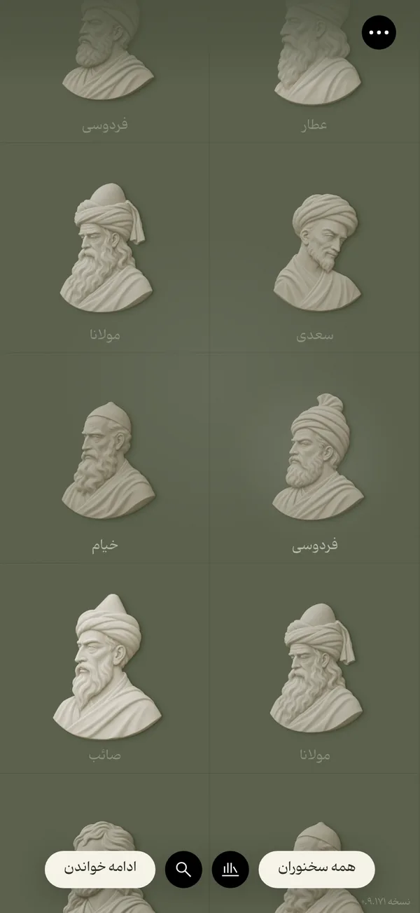
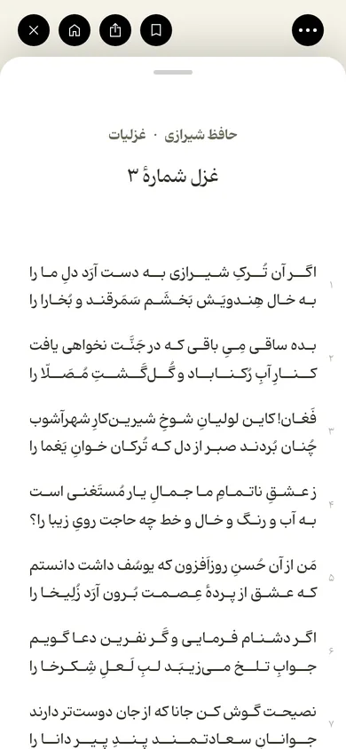
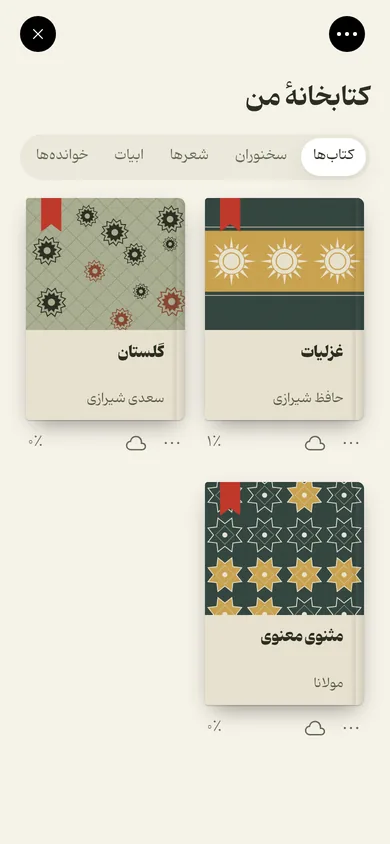
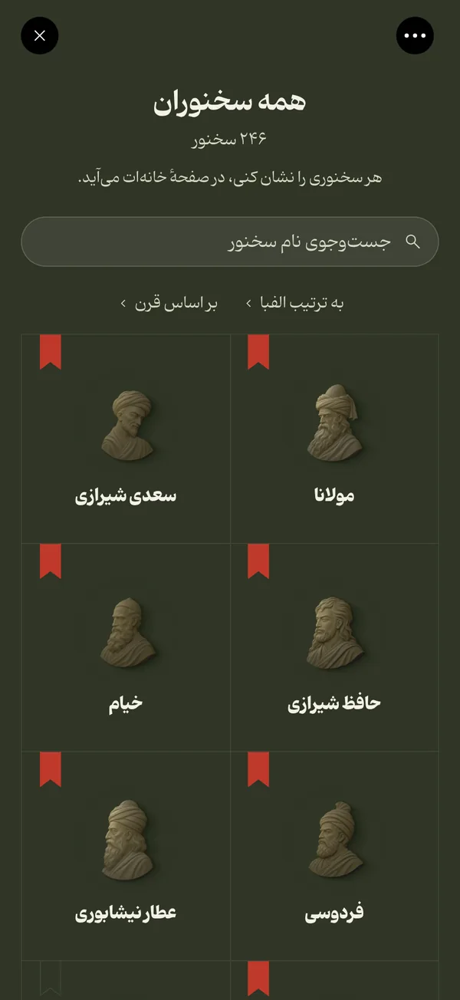
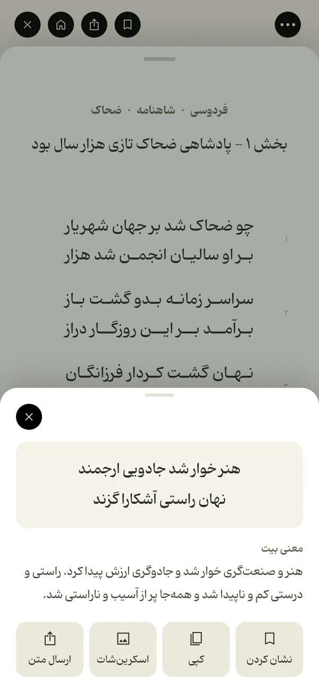

<div align="center">


# شعر پارسی

**خواندن شعر فارسی، ساده و آرام**

A calm, minimal reader for classical Persian poetry

[**navidberahmand.github.io/sher-parsi**](https://navidberahmand.github.io/sher-parsi/)

[فارسی](#فارسی) · [English](#english)

<br>

<table>
  <tr>
    <td></td>
    <td></td>
    <td></td>
  </tr>
  <tr>
    <td></td>
    <td></td>
    <td></td>
  </tr>
</table>

</div>

---

<div dir="rtl">

## فارسی

«شعر پارسی» ساده ساخته شده تا فقط شعر بخوانی، بی‌شلوغی و بی‌حواس‌پرتی. روی گوشی و رایانه کار می‌کند، می‌شود آن را به صفحهٔ اصلی گوشی اضافه کرد و شعرهای دانلودشده بدون اینترنت هم خوانده می‌شوند.

### چه دارد

- **۲۴۶ سخنور و حدود ۱۳۹ هزار شعر** از گنجور، از رودکی تا شهریار، به ترتیب الفبا یا بر اساس قرن.
- **دیوار سخنوران** در صفحهٔ اصلی با چهره‌های گچ‌بری‌شده؛ هر کس سخنوران دلخواهش را روی دیوار می‌گذارد.
- **صفحهٔ شعر آرام**: مصراع‌ها با کشیده هم‌اندازه می‌شوند و هیچ مصراعی در صفحهٔ کوچک دو خط نمی‌شود.
- **معنی بیت و دربارهٔ شعر** با زدن روی هر بیت.
- **کتابخانهٔ من**: نشان کردن کتاب، سخنور، شعر و بیت، با درصد خوانده‌شدهٔ هر کتاب.
- **خواندن آفلاین**: دانلود یک سخنور یا یک کتاب برای خواندن بدون اینترنت.
- **جست‌وجو در همهٔ مصراع‌ها**؛ بدون اینترنت در شعرهای ذخیره‌شده.
- **تصویر برای اشتراک**: از هر بیت یا شعر تصویری برای استوری ساخته می‌شود.
- **تنظیمات خواندن**: اندازه و ضخامت حروف، اِعراب، و حالت شب که تا انتخاب خودتان از تنظیم دستگاه پیروی می‌کند.
- **پشتیبان**: همهٔ نشان‌ها و تنظیمات در یک فایل، برای بردن به دستگاه دیگر.

### حریم خصوصی

ثبت‌نام ندارد و هیچ اطلاعاتی از خواننده نمی‌گیرد. نشان‌ها، تنظیمات و دانلودها فقط روی دستگاه خود خواننده می‌مانند. کوکی، تبلیغ و ابزار آمار ندارد و چیزی از گوگل یا سرویس دیگری بارگذاری نمی‌کند.

### گزارش مشکل

اگر غلطی در متن شعرها دیدید یا جایی درست کار نکرد، در [Issues](https://github.com/NavidBerahmand/sher-parsi/issues) بنویسید یا به berahmand@gmail.com ایمیل بزنید.

### سپاس

- متن شعرها از [گنجور](https://ganjoor.net) و داده‌های عمومی آن ([ganjoor-data](https://github.com/ganjoor/ganjoor-data)).
- معنی‌هایی که با «هوش مصنوعی:» شروع می‌شوند کار [آرمان نژاد](https://dev.arman.ac/posts/largest-commentary-in-the-history-of-persian-poetry/) است؛ بقیهٔ معنی‌ها کار ویراستاران گنجور.
- قلم «کهربا» از [فونت ایران](https://fontiran.com/license/YVO2HC8R)، با مجوز.
- چهره‌های سخنوران کار نوید برهمند است.

</div>

---

## English

«شعر پارسی» (*Sher-e Parsi*, “Persian Poetry”) is a web app for reading classical Persian poetry without clutter. It works on phones and desktops, installs to the home screen, and keeps downloaded poets readable offline. The interface is in Persian.

### Features

- **246 poets and about 139,000 poems** from Ganjoor, browsable A–Z or by century.
- **A wall of carved portraits** on the home page; readers choose which poets it shows.
- **A quiet poem page**: misras are justified with kashida, and a misra never wraps onto a second line, however small the screen.
- **Couplet meanings and poem notes** one tap away.
- **My library**: bookmark books, poets, poems and couplets, with a reading percentage per book.
- **Offline reading** of a whole poet or a single book.
- **Full-text search** over every misra; offline, it searches the poems saved on the device.
- **Shareable images** of a couplet or a poem, sized for stories.
- **Reading settings**: type size and weight, vowel marks, and a dark mode that follows the device until the reader picks one.
- **Backup** of bookmarks and settings to a single file.

### Privacy

No sign-up and no personal data. Bookmarks, settings and downloads stay on the reader's device. No cookies, ads or analytics, and nothing is loaded from Google or any other third party.

### How it is built

| Part | What |
| --- | --- |
| App | Plain HTML, CSS and JavaScript modules; no framework, no build step |
| Offline | Service worker (`sw.js`) with a cached app shell and a separate cache for downloaded poems |
| Data | Ganjoor’s export, bundled as static JSON: one file per book, split into 250-poem parts |
| Search | A prebuilt static index in `data/s/`; the browser fetches only the few pieces a query needs |
| Type | Kahroba variable font, self-hosted |
| Icons | Material Symbols (Sharp), inlined as SVG paths |

```
index.html          the single page
css/app.css         all styles
js/                 app.js (views and router), data.js, store.js, search.js, share.js, wall.js, covers/
data/               44 poets with portraits: manifest.json, p/ poets, b/ books, s/ search index, counts.json
img/poets/          portraits, light and dark
fonts/  icons/      font and app icons
tools/              scripts that build data/ from ganjoor-data
docs/screenshots/   images for this page
```

The other 202 poets live in [sher-parsi-data](https://github.com/NavidBerahmand/sher-parsi-data), because both together are larger than one GitHub Pages site allows. The app reads them from `../sher-parsi-data/data/`.

### Run it locally

Any static web server works. To have every poet, clone both repositories side by side:

```sh
git clone https://github.com/NavidBerahmand/sher-parsi.git
git clone https://github.com/NavidBerahmand/sher-parsi-data.git
python3 -m http.server 8000
```

Then open http://localhost:8000/sher-parsi/.

### Rebuilding the data

With a clone of [ganjoor-data](https://github.com/ganjoor/ganjoor-data) and `sher-parsi-data` beside this repository, run in order: `tools/bundle.py`, `tools/poet_sizes.py`, `tools/poem_counts.py`, then `tools/build_search.py`. A new data fingerprint makes installed copies refresh the poets they have saved.

### Reporting a problem

Open an [issue](https://github.com/NavidBerahmand/sher-parsi/issues) for a typo in a poem or anything that doesn’t work, or write to berahmand@gmail.com.

### Credits

- Poem texts: [Ganjoor](https://ganjoor.net) and its public [ganjoor-data](https://github.com/ganjoor/ganjoor-data) export.
- Meanings marked «هوش مصنوعی:» (AI): [Arman Nejad](https://dev.arman.ac/posts/largest-commentary-in-the-history-of-persian-poetry/). All other meanings: Ganjoor’s editors.
- Typeface: Kahroba by [fontiran](https://fontiran.com/license/YVO2HC8R), licensed.
- Icons: [Material Symbols](https://fonts.google.com/icons) by Google, Apache License 2.0.
- Portraits: Navid Berahmand.

### License

The code is under the MIT License. The poem data stays under Ganjoor’s terms, the Kahroba font is licensed for this site only, and the portraits are all rights reserved. See [LICENSE](LICENSE) for the details.

Made by Navid Berahmand · [berahmand.com](https://berahmand.com)
